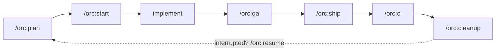

<p align="center">
  
</p>

<h1 align="center">orc</h1>

<p align="center">
  <strong>"Zug zug."</strong> &nbsp;·&nbsp; <em>Let the orcs do the work.</em>
</p>

<p align="center">
  The senior-developer workflow as a Claude Code plugin: <em>plan → implement → QA → ship → CI → release</em>,
  with guardrails that keep it off <code>main</code>, out of your git attribution, and on your own machine.
</p>

<p align="center">
  <a href="LICENSE"></a>
  
  
  
  
</p>

<p align="center">
  <a href="./docs/install.md"><strong>Install</strong></a> &nbsp;·&nbsp;
  <a href="./docs/commands.md"><strong>Commands</strong></a> &nbsp;·&nbsp;
  <a href="./docs/examples/README.md"><strong>Examples</strong></a> &nbsp;·&nbsp;
  <a href="./docs/safety.md"><strong>Is it safe?</strong></a> &nbsp;·&nbsp;
  <a href="./docs/README.md"><strong>All docs</strong></a>
</p>

---

orc is a full-SDLC workflow plugin for Claude Code: **87 curated skills, 29 composite slash commands, 14 specialist subagents, and 10 hook scripts**. The hooks enforce the discipline the model would otherwise talk itself out of: no commits to `main`, no AI-attribution trailers, destructive git gated, dependencies pre-flighted, the rules injected at every session start. One command, `/orc:flow`, drives a feature from "I want X" to "PR merged", and `/orc:ci`, `/orc:release`, `/orc:deps` and `/orc:incident` cover what happens after.

It exists for one reason: every time a senior developer sits down, they already know how the next hour goes. Write the plan, watch the test fail, fix the cause, verify with evidence, ship the PR. orc encodes that loop.

## Install

```bash
curl -fsSL https://raw.githubusercontent.com/HigorAlves/orc/main/cli/install.sh | sh   # 1. the orc CLI
orc doctor --fix                                                                       # 2. runtime tools
orc install                                                                            # 3. enable the plugin
```

Restart Claude Code, type `/orc:`, and the palette fills. Pin a version with `orc install --ref orc--v0.27.0`, or skip the CLI with `/plugin marketplace add HigorAlves/orc`. Checkpoints, requirements and the marketplace-only path: [docs/install.md](./docs/install.md).

## The loop



Run the steps yourself, or let `/orc:flow` run them with a gate at every phase and `orc-implementer` writing the code slice by slice. `/orc:retro` closes the loop by turning a session's friction into environment changes. The full catalog, the agents behind it and the skill library: [docs/commands.md](./docs/commands.md). Nineteen scenarios walked end to end: [docs/examples](./docs/examples/README.md).

## Is it safe?

Yes, and every claim is verifiable in this repo in minutes. No backend, no telemetry; network activity is GitHub for releases and the MCP servers you add. Every guardrail is a short shell script that Claude Code runs as a real hook, and the guard hooks fail closed. The eight iron rules, the guardrail table and the FAQ: [docs/safety.md](./docs/safety.md).

## Docs

| Page | What it answers |
|---|---|
| [docs/README.md](./docs/README.md) | The index: start, use, operate, contribute, decide |
| [docs/install.md](./docs/install.md) | Zero to a verified setup, with checkpoints |
| [docs/commands.md](./docs/commands.md) | Every command, agent and skill, and the CLI |
| [docs/configuration.md](./docs/configuration.md) | Settings, environment variables, the statusline |
| [docs/architecture.md](./docs/architecture.md) | Why the layout is what it is; hooks, state, phase modules |
| [docs/contributing.md](./docs/contributing.md) | Adding a surface under the authoring standard; releasing |

Decisions are recorded in [docs/adr](./docs/adr), terms in [GLOSSARY.md](./GLOSSARY.md), what is in and out of scope in [SCOPE.md](./SCOPE.md), and every release in [CHANGELOG.md](./CHANGELOG.md).

## License

MIT. See [LICENSE](LICENSE).

<p align="center"><sub><strong>Zug zug.</strong> Let the orcs do the work.</sub></p>
